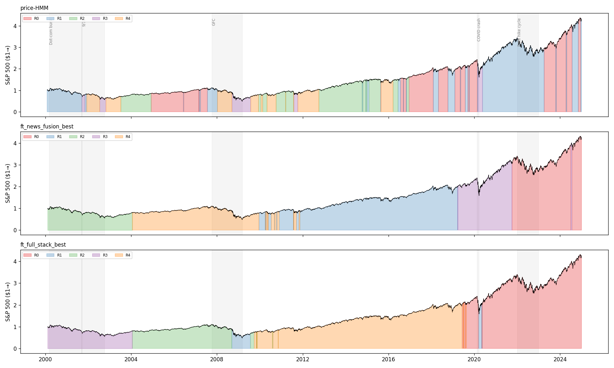
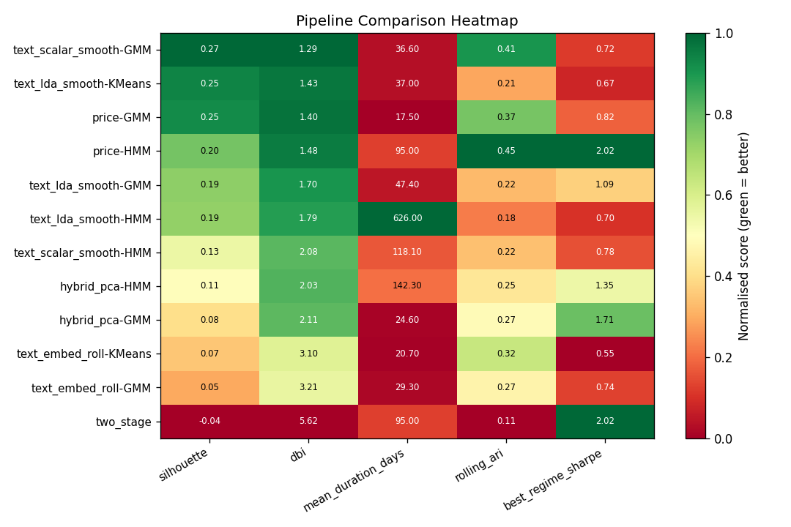

# News-Augmented Market Regime Discovery

**TTIC 31220 — Unsupervised Learning (Spring 2026), final project.**
Yixiang Huang.



## At a glance

Can financial news improve market regime detection beyond what price-derived
features alone provide? This project compares 18 main pipelines + 2 fine-tuned
configurations across three feature families (price-only, news-only,
price+news hybrid) on 6,262 S&P 500 trading days, 2000–2025. Two news corpora
are tested: firm-level press releases (RavenPack DJPR, US `entity_type=COMP`,
relevance ≥ 75) and aggregate macro news (WRDS RavenPack DJ Global Macro,
~24 M rows).

Each pipeline produces a sequence of daily regime labels evaluated on four
proposal-mandated dimensions: statistical fit (BIC / AIC / log-likelihood),
clustering quality (silhouette, Davies-Bouldin), temporal stability (rolling
ARI, mean regime duration) and financial interpretability (per-regime Sharpe,
max drawdown).

## Headline finding

**News lifts silhouette by +35 % over the price-only HMM baseline** (0.20 →
0.27). The sweet-spot configuration discovered by the fine-tuning grid is
**BERTopic + PCA-95 + KMeans K=5** — silhouette 0.279 with a mean regime
duration of 202 days. Adding price on top stabilises regimes further (duration
→ 224 d) with minimal silhouette change. Macro news beats firm-level news
for unsupervised regime discovery.



The full results narrative, with every figure, is in
[`final_analysis.ipynb`](final_analysis.ipynb) (outputs are committed, so it
reads end-to-end without running anything).

---

## Pipeline (01 → 08)

The numbered scripts were exported from the development notebooks of the same
name and keep their `# %%` cell structure. They are written for Google Colab
with the project folder on Google Drive, and fall back to the script directory
when run elsewhere. The orchestrator `run_pipeline.py` runs the chain
end-to-end.

| Script | Input → Output | Purpose |
|---|---|---|
| `01_market_data.py` | CRSP S&P 500 + FRED → `_data/market_features.parquet` | Daily price features: `ret`, `vol_21`, `vix`, `term_spread`, `credit_spread` |
| `02_news_features.py` | `data/ravenpack_djpr.parquet` → `_data/news_features_daily.parquet` | DJPR firm-level daily news scalars (CSS mean/std, n_articles, sentiment) |
| `02d_news_macro.py` | WRDS DJ Global Macro → `_data/news_features_macro_daily.parquet` + `data/ravenpack_macro_cache_{YYYY}.parquet` | Macro corpus pull + daily aggregation. Skip with `--no-macro` |
| `03_embedding_colab.py` | DJPR (+ macro) headlines → `_data/daily_finbert_embeddings{,_macro}.npz` | 768-d FinBERT embeddings, daily mean |
| `04_topic_models.py` | DJPR (+ macro) headlines → `_data/lda_topics_{macro_,}k{15,20}_daily.parquet`, `bertopic_{macro_,}daily.parquet` | LDA K=15/20 + BERTopic topic distributions |
| `05_baseline_price.py` | `market_features` → `_data/regimes_price.parquet` | Price-only GMM (BIC-selected K) and HMM baselines |
| `06_text_hybrid_models.py` | All of the above → `_data/regimes_{text_scalar,text_lda,text_btopic,hybrid,lean_hybrid,macro_supplement,macro_text_supplement,…}.parquet` | 18 main pipelines: text-only / hybrid / macro ablations |
| `07_evaluation.py` | All `regimes_*.parquet` + `eval_cache.json` → `_data/eval_summary.parquet` + `_images/eval_heatmap.png` | Per-pipeline silhouette, DBI, rolling ARI, BIC/AIC/log-lik, per-regime Sharpe |
| `08_regime_characterization.py` | Top-6 pipelines from §7 → `_data/regime_characterization_master.parquet`, `_data/regime_macro_top_headlines.parquet`, `_images/regime_{shares,tl}_*.png`, `_images/regime_tour_4panel.png` | Per-regime stats + top retrieved headlines |

### Method choices worth knowing

- **Per-feature smoothing windows:** scalar 35 d, LDA 30 d, BERTopic 21 d,
  FinBERT 10 d (set in 06; topic features are already daily aggregates and
  need less smoothing).
- **Adaptive HMM covariance:** `dim ≥ 10` triggers diagonal covariance instead
  of full. Fixes an absorbing-state failure mode on high-dim feature stacks
  (mean regime duration was running away to 894 days before this).
- **HMM init:** sticky transition matrix (0.85 diagonal), 300 EM iterations,
  5 random seeds, best by log-likelihood.

---

## Fine-tuning subproject (`finetuning/`)

Two grid sweeps explore the
**{text representation × pre-clustering dim reduction × clustering method × K}**
space for two specific feature fusions. Each grid runs 90 configurations.

| Script | Stack | Best config found |
|---|---|---|
| `ft_news_fusion.py` | DJPR scalar + Macro scalar + DJPR text + Macro text | BERTopic + PCA-95 + KMeans K=5 |
| `ft_full_stack.py`  | Price + everything from A | BERTopic + PCA-95 + KMeans K=5 |
| `promote_best.py`   | — | Writes `_data/regimes_ft_{news_fusion,full_stack}_best.parquet` consumed by 07 |

Results parquets: `_data/ft_{news_fusion,full_stack}_results.parquet`
(one row per config). Top-10 bar charts: `_images/ft_{…}_top10.png`.

See `finetuning/README.md` for grid spec, prerequisites, and how to read the
results.

---

## How to reproduce

End-to-end in Colab (mounts Drive automatically, installs dependencies once
per runtime):

```bash
python run_pipeline.py                # default: --enable-macro, --skip-existing
python run_pipeline.py --no-macro     # firm-level only (skip 02d / macro branches)
python run_pipeline.py --no-skip-existing   # force every step to rerun
python finetuning/ft_news_fusion.py   # ~15-25 min CPU
python finetuning/ft_full_stack.py    # ~15-25 min CPU
python finetuning/promote_best.py     # writes regimes_ft_*_best.parquet
python run_pipeline.py --start-at 07_evaluation.py   # refresh master eval table
```

Rough runtime end-to-end on a fresh Colab CPU runtime: ~3–4 h for the full
chain (FinBERT is the slow step at ~60 min; one-time BERTopic fit ~30 min).
Re-runs with `--skip-existing` (default) take seconds because each step
checks for its key output file.

The orchestrator's flags:

```
--enable-macro / --no-macro            macro pull (02d) + supplement models (06)
--skip-existing / --no-skip-existing   skip steps whose output already exists
--skip-expensive-text                  skip 03 / 04 even if other artifacts missing
--start-at / --stop-after              partial runs
--subprocess                           one Python process per step (default: in-process)
```

---

## Repo layout

```
news-regime-discovery/
├── 01_…_08_*.py, 02d_news_macro.py, run_pipeline.py  ← main pipeline
├── final_analysis.ipynb                              ← consolidated results narrative (outputs committed)
├── finetuning/                                       ← grid-search subproject (90 × 2 configs)
├── _data/                                            ← regime labels, evaluation tables, grid results (see Data access)
├── _images/                                          ← all figures: eval heatmap, regime timelines, grid top-10s, …
├── report/                                           ← final_report.pdf, progress_report.pdf, LaTeX source
├── poster/                                           ← poster.pdf, poster.tex (tikzposter), panel assets
├── proposal/                                         ← original proposal (tex + pdf)
├── requirements.txt, requirements-project.txt        ← dependencies (full / Colab-minimal)
└── README.md
```

Not in the repository: `data/` (raw WRDS RavenPack and CRSP pulls, about 5 GB),
the text-derived caches and embeddings under `_data/`, and `.env` (WRDS
credentials). See [Data access](#data-access) below.

---

## Deliverables

| Where | What |
|---|---|
| [`report/final_report.pdf`](report/final_report.pdf) | Final report; LaTeX source under [`report/source/`](report/source/). |
| [`poster/poster.pdf`](poster/poster.pdf) | 24"×36" portrait poster (tikzposter); the eleven panel assets and their generator are under [`poster/material/`](poster/material/). |
| [`report/progress_report.pdf`](report/progress_report.pdf) | Mid-semester progress report. |
| [`proposal/proposal.pdf`](proposal/proposal.pdf) | Original proposal. |
| [`final_analysis.ipynb`](final_analysis.ipynb) | Consolidated analysis: baselines, text ablation, hybrid fusion, robustness, two-stage regime characterisation, negative results. |

---

## Data sources

- **RavenPack DJPR** (firm-level press releases) — `data/ravenpack_djpr.parquet`, ~3.1 GB. US `entity_type=COMP`, relevance ≥ 75. Provided via WRDS.
- **WRDS DJ Global Macro RavenPack** — pulled by `02d_news_macro.py` into `data/ravenpack_macro_cache_{YYYY}.parquet`, 2000–2026, ~24 M rows total. Entity types: `{MKT, ORGA, PLCE, CMDT, CURR, NATL}`.
- **CRSP** — daily S&P 500 index via WRDS (`crsp.dsi`).
- **FRED** — VIX, 10Y/2Y Treasury yields, Baa/Aaa corporate yields.

## Data access

RavenPack, CRSP and the WRDS macro corpus are licensed data, so nothing derived
from article-level text is redistributed here. Reproducing steps 01–06 needs a
WRDS subscription: put your credentials in a local `.env` (`WRDS_USERNAME`,
`WRDS_PASSWORD`; the file is git-ignored) and run `run_pipeline.py`.

What **is** committed under `_data/`, so the evaluation and the analysis
notebook can be read or re-run without WRDS access:

- `regimes_*.parquet` — daily regime labels from every pipeline (dates and
  integer labels only);
- `eval_summary.parquet`, `eval_cache.json`, `pipeline_stats.json` — the
  four-dimension evaluation tables behind the heatmap;
- `ft_*_results.parquet` — one row per configuration from the two grid sweeps;
- `regime_characterization_master.parquet` — per-regime statistics for the
  top pipelines.

---

## License

Code is released under the [MIT License](LICENSE). The report, poster and
figures are © Yixiang Huang. The underlying data remain subject to the WRDS,
RavenPack and CRSP terms of use and are not distributed with this repository.
